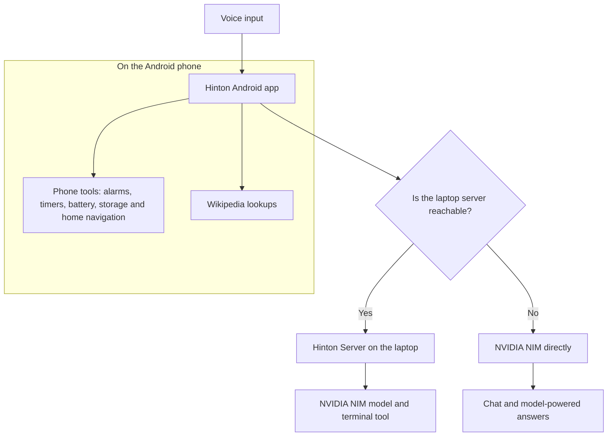

# Hinton App (Android)

Hinton is a voice assistant with an animated astronaut-robot face. It floats over your other apps as a small round bubble, answers by voice, sets and cancels alarms, and, when your laptop is on, can control the laptop's terminal in plain language.

Built for a Samsung Galaxy S23, written in Kotlin. The laptop side lives in the [`hinton-server`](https://github.com/HimanshuThakre/hinton-server) repository.

**Requires Android 7.0 (API 24) or newer.** Newer features are switched on only where the phone's Android version supports them (for example notification channels from Android 8, and the notification permission from Android 13). Only a Samsung Galaxy S23 has been tested so far; older phones may behave differently.

## How it works



The top corner of the app shows **laptop: connected** or **laptop: offline (chat only)**. Hinton works either way; only terminal commands need the laptop.

## Features

### Works anywhere (no laptop needed)

- **Voice chat.** Tap to talk. Speech recognition and speech output use Android's built-in engines.
- **Animated face** that blinks, looks around, and moves its mouth while talking. The ring colour shows the state: listening, thinking, speaking, asking permission.
- **Phone awareness.** Ask for the date, time, battery level, free storage or free memory.
- **Facts from Wikipedia** for people, places, events and topics.
- **Alarms and timers.** "Wake me at 6:30." "Set a 10 minute timer."
- **Cancel alarms.** "Cancel all alarms." "Cancel my next alarm." "Cancel the 7 AM alarm." "Cancel the gym alarm." "Show my alarms."
- **Navigate home.** "Take me home" opens maps with your saved address. The address stays on the phone and is never sent to the model.

### Floating bubble

- A small round Hinton face that floats over other apps. Drag it anywhere; it snaps to the screen edge.
- **Tap** it to talk. **Long-press** it for a bottom bar with a text box, a microphone, and quick buttons (Home, Alarms, Close).
- Replies appear in the bar and are spoken aloud.
- **Drag it onto the X** at the bottom of the screen to close it, or use the notification's **Close bubble** button.

### With your laptop connected

- Say any terminal task in plain language ("What's my disk usage?", "Create a folder called projects"). The laptop runs it and Hinton reads back the result.
- Risky commands pop up **Yes / No** before anything runs.
- Phone tasks (alarms, timers, battery, "take me home") are always handled on the phone, even when the laptop is connected.

## Status and honest limits

- **Early and experimental.** The bubble, alarm cancelling and the phone tools were added recently and need testing on more devices.
- **Cancelling alarms** works by asking the Clock app. Android does not let apps read or delete alarms directly, and the Clock app does not confirm. Hinton will say it *asked* the Clock app to cancel, and opens the alarm list if the request is not supported.
- **The bubble and the microphone.** Android may restrict microphone use for background services on some phones. If the bubble shows a speech error, open Hinton and try again.
- **Samsung battery saver** can close the bubble. Exempt Hinton in Settings > Battery.
- **No always-on "Hey Hinton" yet.** You tap the face or the bubble to talk.
- **Chat only is not the same as the laptop.** Without the laptop, Hinton cannot run terminal commands, and Wikipedia is not live news or weather.

## Roadmap (not built yet)

- **Multi-language answers.** Understand and reply in the language you speak (for example Hindi, Marathi, Tamil, English), with matching speech recognition and voice. Today recognition and voice are set to English (India).
- **Side-key assistant.** Set Hinton as the default assistant so a long-press on the side key opens the bottom bar (like the Gemini bar).
- **Wake word** "Hey Hinton" with a proper engine such as Porcupine.
- **Radial quick-action menu** on the bubble, and optional screen reading or capture (these need extra permissions and have privacy implications).
- **Phone actions:** calls, messages, flashlight, volume.
- **Real web search** (for example Tavily or Brave) for news, weather and prices.

## Build it

You need **Android Studio** or just the command line, Java 21+, and the Android SDK (Android Studio installs it).

```bash
git clone https://github.com/HimanshuThakre/hinton-app.git
cd hinton-app
export JAVA_HOME=/snap/android-studio/current/jbr   # or any Java 21+
chmod +x gradlew
./gradlew assembleDebug --no-daemon
```

The app is `app/build/outputs/apk/debug/app-debug.apk`.

If Gradle complains it cannot download a Java toolchain, rename `gradle/gradle-daemon-jvm.properties` to `gradle/gradle-daemon-jvm.properties.bak` and build again with the `JAVA_HOME` above. If Android Studio runs out of memory, close it and build from a normal terminal as shown.

### Install on your phone

Without a cable, from the folder holding the APK:

```bash
cd app/build/outputs/apk/debug
hostname -I          # note the first address
python3 -m http.server 9000
```

Then on the phone (same Wi-Fi), open `http://<that address>:9000/app-debug.apk` in Chrome, tap the downloaded file, allow installs from Chrome if asked, and press Ctrl+C on the laptop when done. Or use a USB cable with USB debugging on and press Run in Android Studio.

## First run

1. Open Hinton and tap **Settings**.
2. **Laptop address:** only the first address and the port, for example `10.0.0.5:8000`. Leave empty to use chat-only mode.
3. **Pairing token:** the `PAIR_TOKEN` you set on the laptop.
4. **NVIDIA API key:** your own key from <https://build.nvidia.com>.
5. **Model:** pick one that works for you (the default is `nvidia/nemotron-3.5-lightning-30b-a3b`).
6. **Home address:** optional, used only by "take me home".
7. Tap **Save**. Allow the microphone when asked.

To use the bubble, tap **Bubble**, allow **Display over other apps**, then allow the microphone and notifications.

## Try saying

- "What's today's date?" / "How much storage do I have left?" / "What's my battery?"
- "Who is the Prime Minister of India?"
- "Set an alarm for 7 AM." / "Set a 10 minute timer."
- "Cancel all alarms." / "Cancel the 7 AM alarm."
- "Take me home."
- With the laptop connected: "What's my disk usage?" / "List the files in my home folder."

## Privacy and security

- **Your NVIDIA key, pairing token and home address are typed into the app and stay on the phone.** They are not in this repository. Do not commit them.
- Your questions are sent to NVIDIA's servers to be answered. The phone's date, time, battery, storage and memory are sent with each question so Hinton can answer about them. Your **home address is never sent**.
- The connection to your laptop uses a self-signed certificate, so the app accepts it **only for the laptop address you enter**. Use it on networks you trust.
- The bubble shows a notification while it runs, and Android shows the microphone indicator while it listens.

## Project layout

| File | Purpose |
|---|---|
| `MainActivity.kt` | Main screen, settings, bubble button |
| `BubbleService.kt` | The floating bubble and bottom bar |
| `HintonBrain.kt` | Laptop link, direct NVIDIA chat, the tools the model can call |
| `PhoneInfo.kt` | Date, time, battery, storage and memory |
| `PhoneActions.kt` | Alarms, timers, cancel alarms, navigate home |
| `assets/face.html` | The animated face (also used inside the bubble) |

## License

Add a license of your choice (for example MIT) before sharing publicly.
